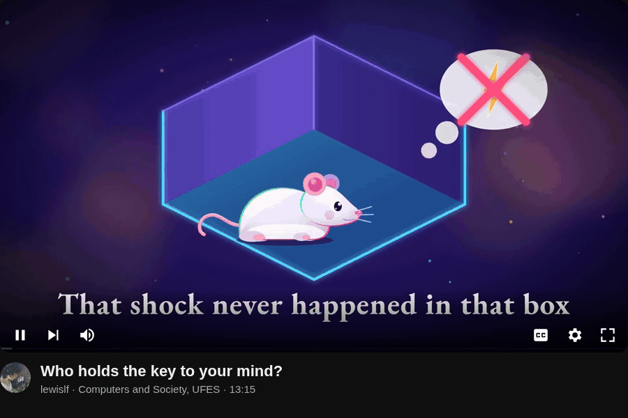

# claude-code-video-studio

**English** · [Português](README.pt-BR.md)

Pipeline to make a narrated explainer video entirely on your machine, with Claude Code directing: script, voice, music,
animated scenes, assembly, sped-up version and cover. No paid API. Voice on OmniVoice, music on MusicGen, scenes in
HTML/SVG/GSAP rendered by [HyperFrames](https://github.com/heygen-com/hyperframes), cover on SDXL via ComfyUI.

[](https://github.com/lewislf/claude-code-video-studio/releases/download/your-mind/your-mind-en-1080p.mp4)

Made with this: *Your mind under terms of use*, 13 minutes on neurotechnology (assignment for Computers and Society,
UFES). It was made in Brazilian Portuguese and then dubbed into English with this pipeline. Full code in
[`examples/your-mind/`](examples/your-mind/).

Click the player to watch in 1080p (716 MB), or the [light 26 MB copy](https://github.com/lewislf/claude-code-video-studio/releases/download/your-mind/your-mind-en-phone.mp4). Description
and chapters in the [release](https://github.com/lewislf/claude-code-video-studio/releases/tag/your-mind); the
[original Portuguese cut](https://github.com/lewislf/claude-code-video-studio/releases/tag/sua-mente) has its own.

## How it works

A video is a folder with a `script.py`. The script is the single source: the voice, the timing of each scene and the assembly all come from it.

```python
SCENES = [
  ("sky", "The sky", [
    ("Look up on a clear day. The sky is blue.", 0.5, {"a": "sky"}),
    ("But sunlight is white.", 1.4, {"a": "prism"}),
  ]),
]
```

Each segment (spoken text, pause, visual) becomes a clip with the exact duration of the speech. Scenes are Python functions that
return HTML; `word("sky", 0, "blue")` gives the instant the voice says "blue", and the animation fires there.

```
script.py ──> tts.py ──> assets/voice/*.wav + durations.json ──> transcribe.py ──> words/*.json
                                   │                                                  │
                                   └──────────> scenes/<group>/build_*.py <───────────┘
                                                        │  scenes.py render
music.py ──> assets/music.mp3 ──> assemble.py <── assets/clips/*.mp4
                                        │
             progress_bar.sh ──> deliver.sh ──> renders/v1-bar-1.35x.mp4 (+ mobile)
```

The narration language is `LANG` in `script.py` (ISO code, default `"en"`). Any language OmniVoice supports works; the example
video is pt-BR. The voice is cloned from a reference clip, and the clip's accent carries over, so the reference has to be in
the narration's language. `studio/voices/` has eight English references made with OmniVoice voice design (deep male US and UK,
older male US, low female US, two takes each) and one Portuguese (`deep_narrator`). Without `VOICE`, English uses
`en_deep_us_b` and other languages use `deep_narrator`; set `VOICE = "en_deep_uk_a"` to pick another, or point it at your own clip.

## Start a video

```bash
cp -r template ~/videos/my-video && cd ~/videos/my-video
ST=~/claude-code-video-studio/studio; PY=<python with omnivoice, faster-whisper and transformers>

$PY $ST/tts.py generate && $PY $ST/tts.py pick          # voice, 3 takes per sentence, keeps the one whisper understands best
python3 $ST/transcribe.py                               # timing of each word
$PY $ST/music.py                                        # music
python3 $ST/scenes.py render g1                         # scenes of group g1 -> clips
python3 $ST/assemble.py                                 # renders/v1.mp4
$ST/progress_bar.sh v1 v1-bar && $ST/deliver.sh v1-bar  # progress bar and 1.35x version
```

With Claude Code it is easier to ask: copy `skills/` to `~/.claude/skills/` and say "make a narrated video about X".
The `narrated-video` skill knows the steps; scenes go to subagents with the `studio/AGENT.md` briefing; the `ai-cover` skill
makes the thumbnail.

| Folder | What it has |
|---|---|
| `studio/` | the pipeline (voice, words, music, scenes, assembly, patching, delivery) and the scene engine |
| `template/` | minimal 20 s project to copy |
| `skills/` | `narrated-video` and `ai-cover` for Claude Code |
| `examples/your-mind/` | the UFES video in English: 72 scenes, script, dub, briefings. Rendering needs the assets (voice, article pages, trailers), which were left out of the repo |

## Requirements

NVIDIA GPU (tested on an 8 GB RTX 5070), Linux with `systemd-run` (the scripts set memory caps), ffmpeg, Node (for
`npx hyperframes`), a Python with `omnivoice`, `faster-whisper` and `transformers`, and ComfyUI with SDXL base for the cover.
`taskline`, if installed, shows progress.

Voice and music are AI-generated; say so in the video description.

## Credits

Made by [lewislf](https://github.com/lewislf) and [FeLiPeOLi7](https://github.com/FeLiPeOLi7).

## License

Code under [MIT](LICENSE). The film and trailer clips cited in `examples/your-mind/film/assets/CREDITS.md`
belong to their owners and are not in the repo. The fly photo
`examples/your-mind/scenes/g3_writing_mapping/assets/fly.jpg` is by Alexis (iNaturalist), CC BY 4.0.
