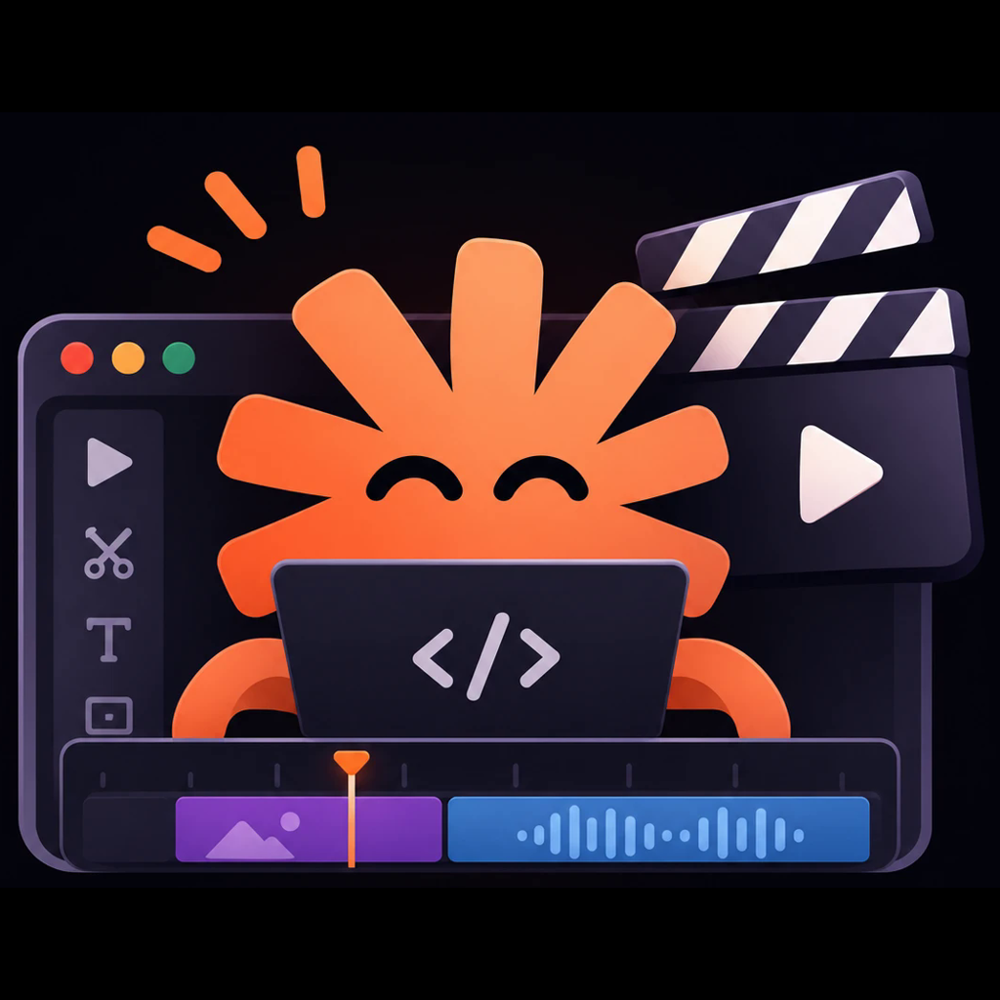
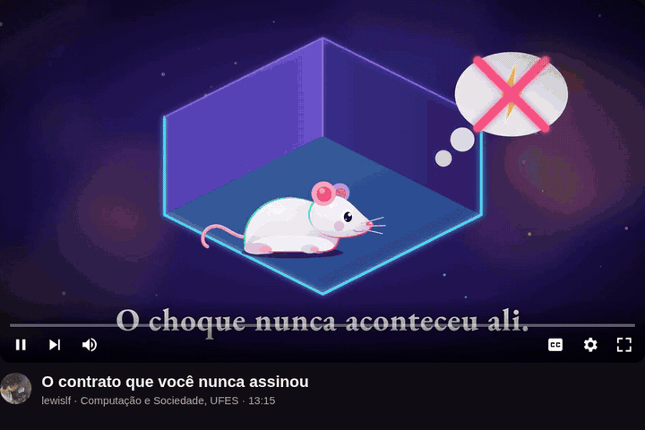

<p align="center">
  
</p>

<h1 align="center">claude-code-video-studio</h1>

<p align="center"><b>Vídeo explicativo narrado feito na sua própria GPU, com o Claude Code dirigindo.</b></p>

<p align="center">
  <a href="LICENSE"></a>
  <a href="#começo-rápido"></a>
  
</p>

<p align="center">
  <a href="#começo-rápido">Começo rápido</a> ·
  <a href="#o-que-sai">O que sai</a> ·
  <a href="#por-que-local">Por que local</a> ·
  <a href="#como-funciona">Como funciona</a> ·
  <a href="#instalação">Instalação</a> ·
  <a href="README.md">English</a>
</p>

Roteiro, voz, trilha, cenas animadas, montagem, versão acelerada e capa, tudo na sua máquina. Voz no OmniVoice, música no
MusicGen, cenas em HTML/SVG/GSAP renderizadas pelo [HyperFrames](https://github.com/heygen-com/hyperframes), capa no SDXL via
ComfyUI. Nenhuma API de voz, música ou vídeo pra pagar.

[](https://github.com/lewislf/claude-code-video-studio/releases/download/sua-mente/sua-mente-1080p.mp4)

Feito com isto: *Sua mente em termos de uso*, 13 minutos sobre neurotecnologia, em português (trabalho de Computação e
Sociedade, UFES). O código completo, já da versão dublada em inglês, está em [`examples/your-mind/`](examples/your-mind/).

Clique no player pra assistir em 1080p (552 MB), ou a [cópia leve de 27 MB](https://github.com/lewislf/claude-code-video-studio/releases/download/sua-mente/sua-mente-celular.mp4). Descrição e capítulos na [release](https://github.com/lewislf/claude-code-video-studio/releases/tag/sua-mente).

## Começo rápido

Instale as skills como plugin do Claude Code:

```bash
claude plugin marketplace add lewislf/claude-code-video-studio
claude plugin install video-studio@claude-code-video-studio
```

Depois é só pedir. Alguns pedidos que funcionam:

- "faz um vídeo narrado sobre por que o céu é azul, 3 minutos"
- "refaz a cena 12, o diagrama ficou pequeno"
- "troca a voz por uma britânica"
- "gera a versão final em 1,35x e manda pro celular"
- "escreve a descrição do YouTube com capítulos" / "faz uma capa"

A skill `narrated-video` sabe as etapas; as cenas vão pra subagentes com o briefing `studio/AGENT.md`; a skill `ai-cover`
gera a thumbnail. A máquina ainda precisa da [instalação](#instalação) abaixo.

## O que sai

- um MP4 por vídeo, com a narração sobre uma trilha baixa e uma barra de progresso fina;
- uma versão acelerada (1,35x por padrão) e uma cópia leve pro celular;
- a voz clonada de um clipe de referência, em qualquer idioma do OmniVoice, com 3 tentativas por frase e o whisper escolhendo
  a mais clara;
- cenas no tempo da palavra: a animação dispara no instante em que a voz fala;
- remendo: refaz uma cena (`patch.py`) ou o áudio inteiro (`swap_audio.py`) sem remontar o resto;
- dublagem: um idioma novo sobre a mesma linha do tempo, com legenda `.srt` (`examples/your-mind/dub.py`, que é como o exemplo
  virou inglês);
- título, descrição e capítulos do YouTube, e capa 1280x720.

## Por que local

Projetos parecidos, pelo que dizem os READMEs deles (novembro de 2026):

| | Voz | Música | Visual |
|---|---|---|---|
| **este repo** | OmniVoice, local, com clonagem | MusicGen, local | cenas HyperFrames escritas pelo Claude, render local |
| [OpenMontage](https://github.com/calesthio/OpenMontage) | Piper offline, ou TTS na nuvem | biblioteca royalty-free ou Suno | banco de vídeos, ou APIs pagas de imagem/vídeo |
| [video_explainer](https://github.com/prajwal-y/video_explainer) | ElevenLabs ou Edge TTS (online) | MusicGen, local | Remotion |
| [Pixelle-Video](https://github.com/AIDC-AI/Pixelle-Video) | Edge TTS (online) ou Index-TTS | arquivos seus | imagens no ComfyUI ou APIs de imagem |

O roteiro continua vindo do Claude Code, então você precisa de um plano do Claude. Todo o resto roda na sua GPU.

## Como funciona

Um vídeo é uma pasta com um `script.py`. O roteiro é a fonte única: dele saem a voz, o tempo de cada cena e a montagem.

```python
SCENES = [
  ("sky", "The sky", [
    ("Look up on a clear day. The sky is blue.", 0.5, {"a": "sky"}),
    ("But sunlight is white.", 1.4, {"a": "prism"}),
  ]),
]
```

Cada segmento (texto falado, pausa, visual) vira um clipe com a duração exata da fala. As cenas são funções Python que
devolvem HTML; `word("sky", 0, "blue")` dá o instante em que a voz diz "blue", e a animação dispara ali.

```
script.py ──> tts.py ──> assets/voice/*.wav + durations.json ──> transcribe.py ──> words/*.json
                                   │                                                  │
                                   └──────────> scenes/<group>/build_*.py <───────────┘
                                                        │  scenes.py render
music.py ──> assets/music.mp3 ──> assemble.py <── assets/clips/*.mp4
                                        │
             progress_bar.sh ──> deliver.sh ──> renders/v1-bar-1.35x.mp4 (+ mobile)
```

O idioma da narração é o `LANG` do `script.py` (código ISO, padrão `"en"`). Funciona qualquer idioma que o OmniVoice suporte;
o vídeo de exemplo é em pt-BR. A voz é clonada de um clipe de referência e o sotaque do clipe vem junto, então a referência
tem que estar no idioma da narração. Em `studio/voices/` há oito referências em inglês feitas com o voice design do OmniVoice
(masculina grave americana e britânica, masculina mais velha americana, feminina grave americana, duas versões de cada) e uma
em português (`deep_narrator`). Sem `VOICE`, inglês usa `en_deep_us_b` e os outros idiomas usam `deep_narrator`; `VOICE = "en_deep_uk_a"`
escolhe outra, ou aponte pra um clipe seu.

## Rodar na mão

O mesmo pipeline sem as skills:

```bash
cp -r template ~/videos/meu-video && cd ~/videos/meu-video
ST=~/claude-code-video-studio/studio; PY=~/.venvs/studio/bin/python   # o ambiente da Instalação

$PY $ST/tts.py generate && $PY $ST/tts.py pick          # voz, 3 tentativas por frase, fica a que o whisper entende melhor
python3 $ST/transcribe.py                               # tempo de cada palavra
$PY $ST/music.py                                        # trilha
python3 $ST/scenes.py render g1                         # cenas do grupo g1 -> clipes
python3 $ST/assemble.py                                 # renders/v1.mp4
$ST/progress_bar.sh v1 v1-bar && $ST/deliver.sh v1-bar  # barra de progresso e versão 1,35x
```

| Pasta | O que tem |
|---|---|
| `studio/` | o pipeline (voz, palavras, música, cenas, montagem, remendo, entrega) e o motor das cenas |
| `template/` | projeto mínimo de 20 s pra copiar |
| `skills/` | `narrated-video` e `ai-cover` pro Claude Code |
| `examples/your-mind/` | o vídeo da UFES em inglês: 72 cenas, roteiro, dublagem, briefings. O render precisa dos assets (voz, páginas de artigo, trailers), que ficaram fora do repo |

## Instalação

GPU NVIDIA (testado numa RTX 5070 de 8 GB), Linux com `systemd-run` (os scripts põem teto de memória), ffmpeg e Node 22+
(pro `npx hyperframes@0.8.185`). Voz, tempo das palavras e trilha usam um ambiente Python 3.11:

```bash
python3.11 -m venv ~/.venvs/studio
~/.venvs/studio/bin/pip install torch torchaudio torchvision --index-url https://download.pytorch.org/whl/cu128
~/.venvs/studio/bin/pip install "omnivoice @ git+https://github.com/debpalash/VoiceStudio@73b83768bdc02dd7068c5c2fefcfa0530fa622e4" \
  faster-whisper transformers accelerate soundfile librosa
```

O ambiente ocupa uns 9 GB. Testado do zero com torch 2.11 (cu128), o VoiceStudio no commit fixado, faster-whisper 1.2.1 e
transformers 5.22; o vídeo do template sai inteiro. Instale o `torchvision` pelo índice do PyTorch junto com o torch: a cópia
que o pip puxa pro `omnivoice` não bate com o build cu128 e quebra o import. Os pesos do OmniVoice e do MusicGen baixam do
Hugging Face na primeira execução. A capa precisa do ComfyUI com o SDXL base (veja
`skills/ai-cover/SKILL.md`). O `taskline`, se instalado, mostra o progresso.

## O que roda e o que baixa

Tudo roda na sua máquina. O plugin não envia dado nenhum: sem telemetria, sem chamada de API própria. Ele baixa:

- os pesos do OmniVoice, do whisper e do MusicGen do Hugging Face, na primeira execução de cada etapa;
- o `hyperframes@0.8.185` do npm via `npx`, pra renderizar as cenas e marcar o tempo das palavras (usa um Chrome headless local);
- o GSAP 3.14.2 do cdn.jsdelivr.net e as fontes do fonts.googleapis.com, carregados pelas páginas das cenas durante o render;
- os pacotes Python da [Instalação](#instalação), quando você instala.

As skills rodam os scripts de `studio/` com `python3`, `ffmpeg` e `systemd-run`, dentro da pasta do vídeo, e a skill
`ai-cover` conversa com um servidor ComfyUI em `127.0.0.1`.

## Licenças dos modelos

O código daqui é MIT, mas os modelos têm termos próprios, e são eles que decidem o que você pode fazer com o vídeo:

- pesos do MusicGen (`facebook/musicgen-small`): CC-BY-NC 4.0, **não comercial**. Em canal monetizado, troque a trilha por uma
  que você tenha direito de usar.
- OmniVoice: o pacote `omnivoice` (VoiceStudio) é AGPL-3.0; os pesos `k2-fsa/OmniVoice` seguem o model card deles.
- SDXL base: CreativeML Open RAIL++-M.

Voz e música são geradas por IA; diga isso na descrição do vídeo.

## Créditos

Feito por [lewislf](https://github.com/lewislf) e [FeLiPeOLi7](https://github.com/FeLiPeOLi7).

## Licença

Código sob [MIT](LICENSE). Os trechos de filmes e trailers citados em `examples/your-mind/film/assets/CREDITS.md`
pertencem aos seus donos e não estão no repo. A [foto da mosca](examples/your-mind/scenes/g3_writing_mapping/assets/fly.jpg) é de Alexis (iNaturalist), CC BY 4.0.
